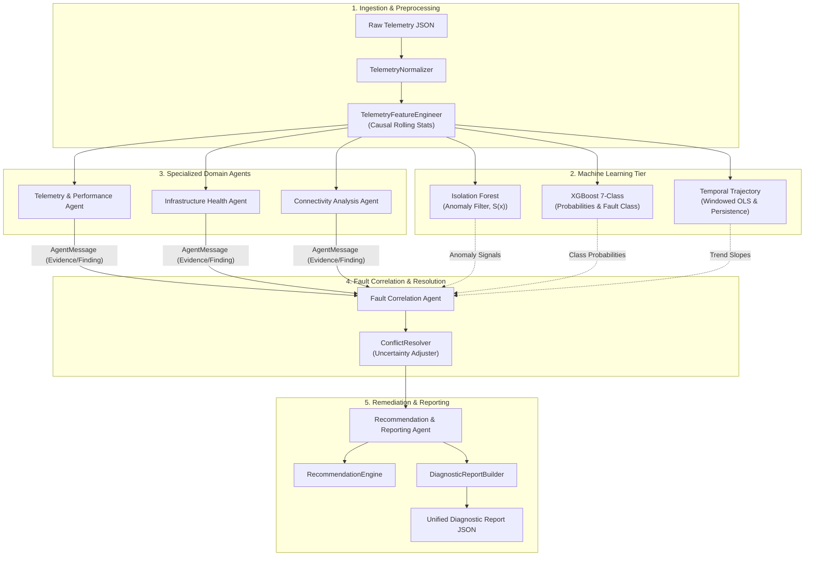

# NetCoop AI — Central Multi-Agent Orchestration & Unified Diagnosis Architecture

## 1. Executive Summary

NetCoop AI is a distributed, multi-agent network fault diagnosis system developed for campus network environments. Phase 4 establishes the central orchestration service (`MultiAgentOrchestrator`), unifying:
1. Ingestion and causal rolling feature engineering (`TelemetryFeatureEngineer`, `TelemetryNormalizer`).
2. Three machine learning pipelines (Unsupervised Isolation Forest, Supervised XGBoost Multi-Class Fault Classification, and Deterministic Sequence Trajectory Analysis).
3. Three specialized domain diagnostic agents (`TelemetryPerformanceAgent`, `InfrastructureHealthAgent`, `ConnectivityAnalysisAgent`).
4. Cross-domain topology and conflict resolution (`FaultCorrelationAgent`, `ConflictResolver`).
5. Actionable remediation planning and unified reporting (`RecommendationReportingAgent`, `DiagnosticReportBuilder`).
6. A high-performance FastAPI endpoint suite (`/api/diagnosis/*`).



---

## 2. Specialized Agent Responsibilities

| Agent Identifier | Class Name | Monitored Metrics | Core Diagnostic Scope |
| :--- | :--- | :--- | :--- |
| `telemetry_performance` | `TelemetryPerformanceAgent` | `latency_ms`, `packet_loss_pct`, `jitter_ms`, `throughput_mbps`, `bandwidth_utilization_pct`, `queue_drops`, `retransmissions` | Buffer overflow, throughput collapse, latency spikes, TCP retransmissions, uplink bandwidth saturation. |
| `infrastructure_health` | `InfrastructureHealthAgent` | `cpu_usage_pct`, `memory_usage_pct`, `temperature_celsius`, `device_uptime_seconds`, `interface_errors`, `queue_drops` | Control-plane CPU lockups (>95%), thermal limits (>75°C), physical layer CRC errors, unplanned supervisor reboots. |
| `connectivity_analysis` | `ConnectivityAnalysisAgent` | `dns_response_time_ms`, `dns_resolution_status`, `dhcp_status`, `gateway_reachability`, `wireless_signal_strength_dbm` | DNS query timeouts, DHCP exhaustion, gateway dropouts, wireless RF attenuation (RSSI <= -75 dBm on APs). Preserves awareness that missing RSSI on switches/routers is normal. |
| `fault_correlation` | `FaultCorrelationAgent` | Domain agent findings, topology segments, ML predictions, temporal trajectories | Topology segment mapping, multi-device vs isolated fault identification, evidence conflict resolution, primary & alternative hypothesis generation. |
| `recommendation_reporting` | `RecommendationReportingAgent` | Correlated diagnostic hypotheses, supporting evidence trail, device identifiers | Step-by-step remediation plans prioritized by severity (Immediate, High, Medium, Low), uncertainty disclosure, unified API report assembly. |

---

## 3. Protocol Message Flow & Shared Context

Every inter-agent exchange strictly adheres to the universal `AgentMessage` envelope (v1.0):

```json
{
  "message_id": "MSG-A1B2C3D4",
  "protocol_version": "1.0",
  "sender": "telemetry_performance",
  "receiver": "fault_correlation",
  "message_type": "evidence",
  "timestamp": "2026-10-31T17:30:00Z",
  "correlation_id": "INC-1001",
  "payload": {
    "evidence_id": "EVD-F8E9D0C1",
    "incident_id": "INC-1001",
    "source_agent": "telemetry_performance",
    "evidence_type": "buffer_overflow_queue_drops",
    "description": "Severe buffer saturation detected with 420 interface queue drops.",
    "device_id": "SW-DIST-01",
    "observed_at": "2026-10-31T17:30:00Z",
    "metadata": {"metric": "queue_drops", "observed": 420, "expected": "0 drops"}
  }
}
```

### Shared Context Structure
The orchestrator maintains an execution context dictionary passed to downstream agents:
```python
shared_context = {
    "incident_id": "INC-1001",
    "receiver": AgentId.FAULT_CORRELATION,
    "anomaly_detection": {
        "is_anomalous": True,
        "max_anomaly_score": 0.1245,
        "decision_threshold": -0.044535,
    },
    "ml_prediction": {
        "predicted_fault": "congestion",
        "confidence": 0.9450,
        "class_probabilities": {"congestion": 0.945, "normal": 0.021, ...},
        "top_alternative_faults": [{"fault": "latency_spike", "probability": 0.025}],
    },
    "temporal_analysis": {
        "overall_trend": "worsening",
        "sequence_evidence": [...],
    },
}
```

---

## 4. Machine Learning Model Integration & Limitations

All three ML pipelines are loaded, cached, and managed by `ModelService`:

1. **Isolation Forest Anomaly Detector (`isolation_forest.joblib`)**:
   - *Role*: Unsupervised anomaly indicator.
   - *Trained On*: 750 clean normal records (`scenario_label == 'normal'`).
   - *Threshold*: `-0.044535` (tuned on validation set to maximize $F_2$-score).
   - *Performance*: Test Recall = **99.85%** (1,348/1,350 faults detected).
   - *Known Limitation*: High false-positive rate on normal telemetry (194 FP / 200 normal records) due to aggressive $F_2$ recall tuning. Treated as an anomaly flag, never as conclusive root cause.
2. **XGBoost Multi-Class Fault Classifier (`xgboost_classifier.joblib`)**:
   - *Role*: Supervised classification over 7 canonical scenarios (`normal`, `congestion`, `dns_dhcp_failure`, `hardware_failure`, `weak_wifi`, `interface_fault`, `latency_spike`).
   - *Performance*: Test Accuracy = **86.52%**, Macro F1 = **0.8747**, ROC-AUC = **0.9730**.
   - *Features*: Exactly 18 numerical telemetry metrics.
3. **Sequence Temporal Pattern Analyzer**:
   - *Role*: Chronological trajectory evaluation using windowed linear regression and persistence counters.
   - *Outputs*: Trend direction (`worsening`, `recovering`, `stable`), degradation rate, and qualitative evidence.

---

## 5. API Endpoints Reference

### 1. `POST /api/diagnosis/analyze`
Executes end-to-end multi-agent network fault diagnosis.

**Request Example:**
```json
{
  "incident_id": "INC-2026-001",
  "telemetry_records": [
    {
      "device_id": "SW-DIST-01",
      "device_type": "switch",
      "latency_ms": 195.0,
      "packet_loss_pct": 4.2,
      "jitter_ms": 32.0,
      "throughput_mbps": 940.0,
      "bandwidth_utilization_pct": 95.0,
      "cpu_usage_pct": 48.0,
      "memory_usage_pct": 52.0,
      "queue_drops": 420,
      "interface_errors": 0,
      "retransmissions": 75
    }
  ],
  "context": {
    "campus_zone": "Science Complex"
  }
}
```

**Response Example:**
```json
{
  "incident_summary": {
    "incident_id": "INC-2026-001",
    "timestamp": "2026-11-01T03:56:10.123456Z",
    "overall_status": "DEGRADED",
    "severity": "high",
    "affected_devices": ["SW-DIST-01"],
    "affected_device_count": 1,
    "affected_network_segments": ["Distribution Aggregation Tier"]
  },
  "probable_root_cause": {
    "primary_hypothesis": "Network Uplink Congestion & Queue Buffer Saturation",
    "confidence": "high",
    "alternative_hypotheses": [
      "Upstream transit provider throttling",
      "Microburst traffic surge exceeding queue depth"
    ],
    "explanation": "Simultaneous link saturation and buffer queue overflow affecting 1 devices across Distribution Aggregation Tier."
  },
  "machine_learning_signals": {
    "anomaly_detection": {
      "available": true,
      "is_anomalous": true,
      "max_anomaly_score": 0.1189,
      "decision_threshold": -0.044535
    },
    "fault_classification": {
      "available": true,
      "predicted_fault": "congestion",
      "confidence": 0.9412,
      "class_probabilities": {
        "congestion": 0.9412,
        "latency_spike": 0.0315,
        "normal": 0.0120
      }
    },
    "temporal_trajectory": {
      "overall_trend": "worsening"
    }
  },
  "evidence_trail": [
    {
      "evidence_id": "EVD-A101",
      "source_agent": "telemetry_performance",
      "evidence_type": "buffer_overflow_queue_drops",
      "device_id": "SW-DIST-01",
      "description": "Severe buffer saturation detected with 420 interface queue drops."
    }
  ],
  "agent_findings": [...],
  "recommended_corrective_actions": [
    {
      "action": "Inspect Uplink Capacity and Top Bandwidth Consumers",
      "priority": "Immediate",
      "target_devices": ["SW-DIST-01"],
      "rationale": "Uplink bandwidth saturation and buffer drops detected on SW-DIST-01.",
      "step_order": 1
    },
    {
      "action": "Audit and Tune Interface Queue Depth / QoS Policies",
      "priority": "High",
      "target_devices": ["SW-DIST-01"],
      "rationale": "Adjust Weighted Random Early Detection (WRED) or queue buffer allocations.",
      "step_order": 2
    }
  ],
  "uncertainty_and_limitations": {
    "confidence_assessment": "high",
    "limitations": [
      "Condition isolated to a single device; potential device-local anomaly.",
      "This diagnosis represents an evidence-weighted hypothesis based on current telemetry; it is not guaranteed to be 100% conclusive without on-site physical/packet verification."
    ],
    "conflicting_evidence": []
  },
  "orchestration_metadata": {
    "orchestrator_version": "1.0.0",
    "protocol_version": "1.0",
    "execution_time_ms": 42.15,
    "agents_executed_count": 5,
    "total_domain_messages": 4
  }
}
```

### 2. `GET /api/diagnosis/agents`
Returns operational statuses for all 5 specialized agents.

### 3. `GET /api/diagnosis/models`
Returns cached operational statuses, algorithms, thresholds, and performance notes for all registered ML models.

---

## 6. How to Run Tests

From the backend virtual environment:

```powershell
cd backend

# 1. Run targeted Phase 4 Orchestration tests
.\venv\Scripts\pytest -v tests/test_orchestration

# 2. Run targeted Phase 4 Diagnosis API tests
.\venv\Scripts\pytest -v tests/test_diagnosis_api

# 3. Run all specialized agents tests
.\venv\Scripts\pytest -v tests/test_agents

# 4. Run full regression test suite
.\venv\Scripts\pytest -v tests
```
